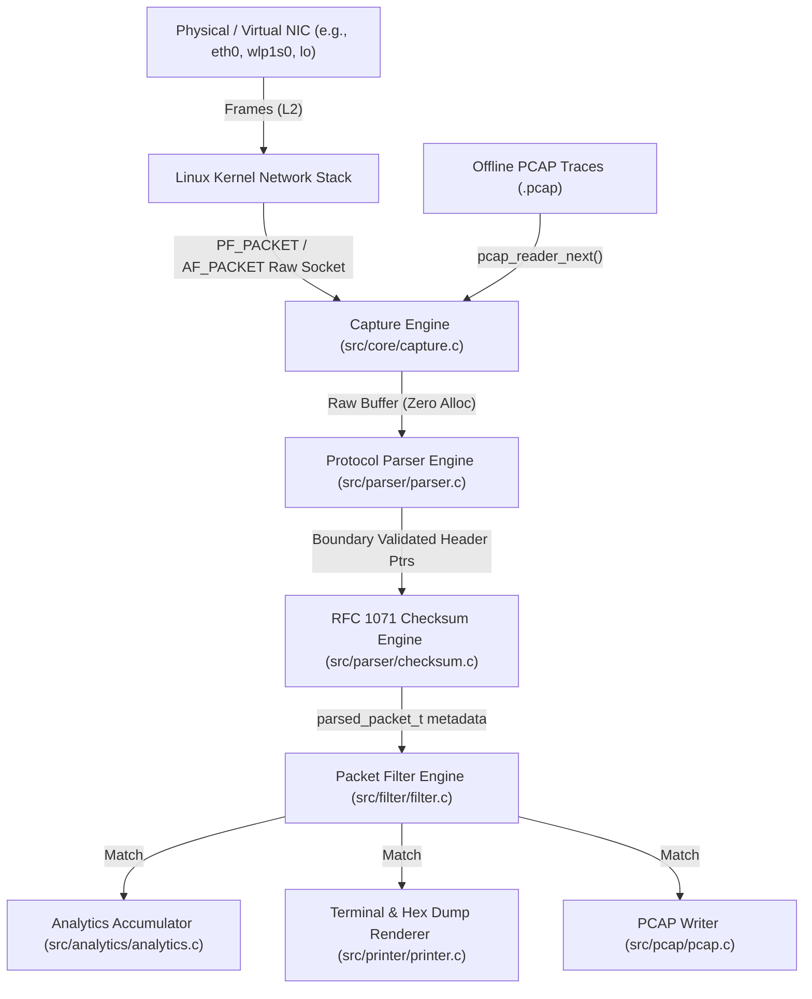

# Architecture Specification: Linux Raw Socket Network Packet Analyzer

This document details the systems architecture, design patterns, memory model, and network stack interactions of the **Linux Raw Socket Network Packet Analyzer**. The design is modeled after high-throughput network systems principles relevant to Cisco Silicon One routing and switching platforms.

---

## 1. High-Level Subsystem Architecture

The analyzer follows a modular, zero-allocation pipeline where incoming frames traverse distinct decoupled stages:

---

## 2. Core Subsystems

### 2.1 Ingestion Layer (`src/core/capture.c`, `include/sniffer/capture.h`)
- **Socket Family:** `AF_PACKET` (packet-level access bypassing network layer processing).
- **Socket Type:** `SOCK_RAW` (preserves Ethernet headers, MAC addresses, and EtherType).
- **Protocol:** `htons(ETH_P_ALL)` (captures all incoming and outgoing link-layer protocols).
- **Socket Buffer Tuning:**
  - Standard Linux default socket receive buffers (~212 KB) overflow and drop packets under traffic bursts.
  - The capture engine dynamically escalates receive buffers using `SO_RCVBUFFORCE` (requiring `CAP_NET_ADMIN` or root) or falls back to `SO_RCVBUF` up to 4 MB.
- **Kernel Drop Telemetry:**
  - Queries `getsockopt(fd, SOL_PACKET, PACKET_STATISTICS, &stats, ...)` to inspect `tp_packets` (packets passed to socket) and `tp_drops` (packets discarded due to kernel buffer saturation).
- **Promiscuous Mode Management:**
  - Configured via `setsockopt(..., SOL_PACKET, PACKET_ADD_MEMBERSHIP, &mreq)` using `PACKET_MR_PROMISC`. Restores interface state upon graceful shutdown.
- **Non-Blocking / Responsive Termination:**
  - Configures `SO_RCVTIMEO` to 250ms timeouts so the ingestion loop can periodically inspect the async-signal-safe flag `g_running` upon `SIGINT`/`SIGTERM`.

### 2.2 Parser Pipeline (`src/parser/parser.c`, `include/sniffer/parser.h`)
The parser operates as a deterministic, recursive header peeling pipeline:
1. **Zero-Allocation Invariant:** No `malloc` or heap manipulation is permitted in the parsing hot path. Memory is passed via a caller-owned `parsed_packet_t` stack or global buffer.
2. **Memory Alignment & Strict Aliasing Guarantee:**
   - Standard Ethernet frames have a 14-byte header (`14 % 4 == 2`), which inherently forces all subsequent L3 (IPv4/IPv6) and L4 (TCP/UDP/ICMP) headers to sit at unaligned 2-byte offsets.
   - Direct structure-pointer casts into raw packet buffers (e.g., `struct iphdr *iph = (struct iphdr *)(buf + 14)`) trigger Undefined Behavior in C (ISO/IEC 9899 §6.3.2.3) and fault on strict alignment architectures (ARM, SPARC, MIPS).
   - The engine copies header fields into naturally aligned local stack structures via `memcpy` before member access, completely eliminating unaligned memory dereferences while maintaining full compiler vectorization and zero UB.
3. **Strict Bounds Checking:** Every header access checks `offset + sizeof(Header) <= caplen` before reading.
4. **Layer 2 (Ethernet & VLAN):**
   - Validates minimum Ethernet frame length (14 bytes).
   - Detects IEEE 802.1Q (EtherType `0x8100`) and IEEE 802.1ad Provider Bridging (QinQ, EtherType `0x88A8`).
   - Extracts 12-bit VLAN Identifier (VID), 3-bit Priority Code Point (PCP), and Drop Eligible Indicator (DEI).
   - Resolves stacked VLAN headers and adjusts Layer 3 offsets dynamically.
5. **Layer 3 (IPv4 & IPv6):**
   - **IPv4:** Validates `version == 4`, `ihl >= 5`, and bounds `offset + ihl * 4 <= caplen`. Handles variable IP option headers. Decodes fragmentation flags (`DF`, `MF`) and fragment offsets.
   - **IPv6:** Validates `version == 6`. Iterates through IPv6 extension headers (Hop-by-Hop `0`, Routing `43`, Fragment `44`, AH `51`, Destination Options `60`) using a bounded loop (max 8 headers) to prevent denial-of-service via cyclical headers.
6. **Layer 4 (TCP, UDP, ICMP, ICMPv6):**
   - **TCP:** Validates `doff >= 5` (20 bytes). Extracts 8 TCP control flags (FIN, SYN, RST, PSH, ACK, URG, ECE, CWR). Decodes sequence and acknowledgment numbers. Computes payload offset and bounds-safe payload length.
   - **UDP:** Validates `len >= 8`. Extracts ports and computes true payload length, accounting for Ethernet padding.
   - **ICMP / ICMPv6:** Decodes type, code, and type-specific fields (e.g., Echo Request/Reply ID and sequence).

### 2.3 Checksum Verification Subsystem (`src/parser/checksum.c`, `include/sniffer/checksum.h`)
- Implements standard RFC 1071 16-bit 1's complement arithmetic using a 32-bit accumulator.
- **Strict Aliasing & Unaligned Access Safety:**
  - Network frames frequently have unaligned L3/L4 offsets (e.g., 14-byte Ethernet header offsets 32-bit IP addresses by 2 bytes).
  - Direct pointer casting `(uint16_t *)ptr` causes undefined behavior, faulting on strict-alignment architectures and triggering incorrect compiler optimizations under `-O3`.
  - The accumulator employs `memcpy` for 16-bit word fetches, enabling GCC/Clang vectorization while preserving strict-aliasing compliance.
- **Pseudo-Header Checksums:**
  - Computes standard 12-byte IPv4 pseudo-headers (`src_ip`, `dst_ip`, `zero`, `protocol`, `length`).
  - Computes RFC 8200 40-byte IPv6 pseudo-headers (`src_ip`, `dst_ip`, 32-bit `length`, 3-byte zeros, `next_header`).

### 2.4 Filtering Engine (`src/filter/filter.c`, `include/sniffer/filter.h`)
- Evaluates packets against a multi-field filter:
  - **Protocol:** Matching on TCP, UDP, ICMP, ICMPv6, IPv4, IPv6, ARP, VLAN.
  - **IP Addresses:** Exact or CIDR subnet matching (e.g., `192.168.1.0/24` or `2001:db8::/32`).
  - **Port Ranges:** Single ports or inclusive port intervals (e.g., `1-1024`).
- Filter evaluation is executed immediately after header parsing, minimizing downstream analytics and printing overhead.

### 2.5 Analytics & Frequency Subsystem (`src/analytics/analytics.c`, `include/sniffer/analytics.h`)
- **Bounded Memory Model:**
  - Maintains a fixed-size hash table (4,096 buckets) for source and destination IP frequencies.
  - Uses the FNV-1a non-cryptographic hashing algorithm over 4-byte (IPv4) or 16-byte (IPv6) addresses.
  - Collisions are resolved using open addressing with linear probing (capped at 64 probes).
  - Eliminates dynamic memory allocations in the packet ingestion path.
- **Top-N Reporting:**
  - Collects active hash buckets into a pointer array and executes an in-place `qsort` to extract top 10 IP talkers by packet count, byte volume, and traffic percentage.

---

## 3. Cisco Silicon One vs. Software Packet Sniffer

To bridge this Linux software implementation with Cisco Silicon One ASIC architecture:

| Concept | Linux Raw Socket Packet Analyzer | Cisco Silicon One Architecture |
|---|---|---|
| **Pipeline Model** | Sequential CPU instructions on x86 cores | Hardware pipeline running programmable P4/NPL microcode at line-rate |
| **Parsing Rate** | ~22 - 30 Mpps (~12 - 21 Gbps) per CPU core | Line-rate 25.6 Tbps / 51.2 Tbps (>8 Billion packets/sec per ASIC) |
| **Packet Buffer** | Linux socket receive buffer (`SO_RCVBUF`, 4MB) in DRAM | Deep on-chip High Bandwidth Shared Memory (HBM) with Virtual Output Queuing (VoQ) |
| **Ingress Filtering** | Software comparison loop (`filter_matches()`) | Hardware Ternary Content Addressable Memory (TCAM) & Exact Match Tables |
| **Checksum Handling** | Software RFC 1071 1's complement accumulator | Hardware Parser Checksum Engines calculating / verifying in single clock cycles |
| **Packet Ingestion** | Linux kernel sk_buff copy via `recvfrom()` | Zero-copy Direct Memory Access (DMA) / Integrated SerDes MAC interfaces |

---

## 4. Signal Safety and Concurrency

- **Async-Signal Safety:**
  - Legacy implementations often invoke unsafe operations (`malloc`, `free`, `printf`, `fclose`) inside signal handlers, causing deadlocks if interrupted while holding stdio locks.
  - This architecture uses a `volatile sig_atomic_t g_running` flag. The signal handler sets `g_running = 0`, allowing the main event loop to cleanly exit, print analytics, close PCAP handles, and release OS resources.
